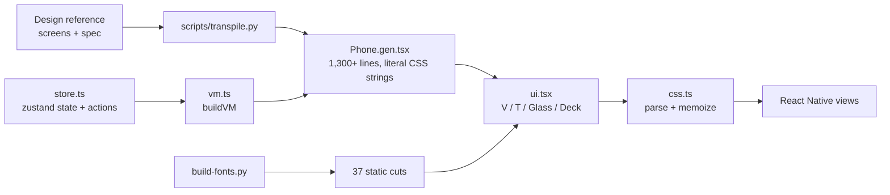
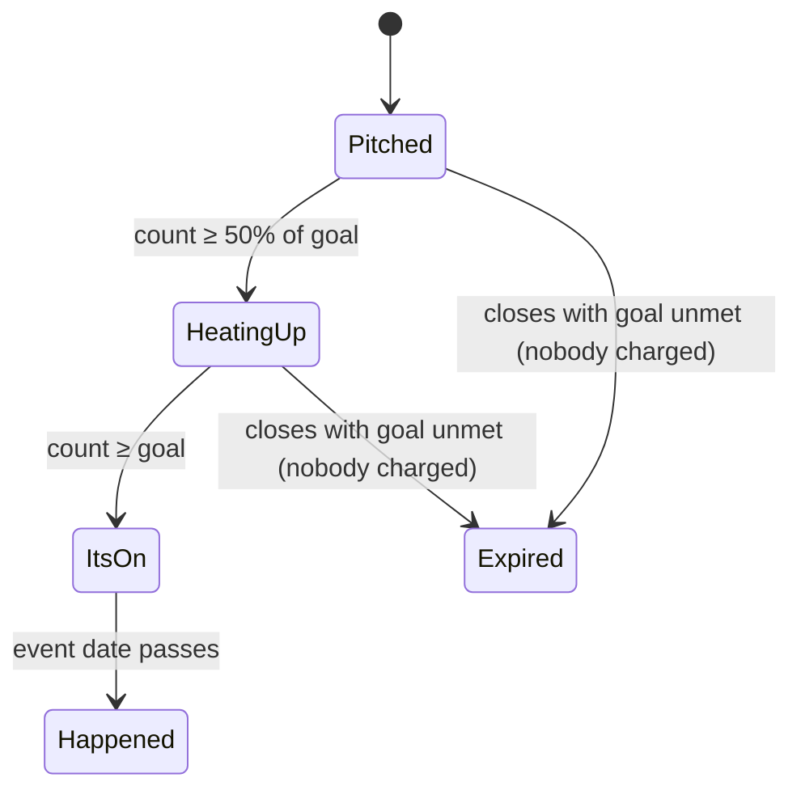

# Design: down. native app

## Overview

The reference is a single 390×844 phone canvas whose screens are layered: four tabs (Swipe, Map, Squad, Host) plus sheets and overlays (Plan detail, Lock it in, Inbox, Pitch, Profile, You're going, It's on, Onboarding, Lock screen, Toast). We keep that shape: one route, one store, every screen always mounted and toggled, so state carries across tabs exactly like the reference and every transition is a property change.

To hit "pixel-exact" without retyping hundreds of values, screens are **generated** from the reference markup, and a small runtime renders CSS-style values natively.



## Components

### `css.ts`: style engine
Parses an inline CSS string once (memoized) into:
- `view` styles: flexbox, box model, borders, radii, shadows (`boxShadow` strings), gradients (`backgroundImage` with `radial-gradient` / `linear-gradient`, supported natively by RN 0.88), transforms, transitions.
- `text` declarations that inherit (font shorthand, letter-spacing in em, color, alignment, white-space, text-wrap).
- special layers RN can't draw: `backdrop-filter` (glass), `conic-gradient` rings, `repeating-linear-gradient` barcodes, dashed top borders, `drop-shadow`.

CSS `transition: transform .45s cubic-bezier(.2,.9,.2,1)` maps 1:1 onto Reanimated 4 CSS transitions (`transitionProperty / Duration / TimingFunction / Delay`), so every sheet, toast and progress fill animates with the reference timing.

### `ui.tsx`: primitives
- `<V s="css">` mirrors CSS layout: `display:flex` → row unless a direction is set; block flow otherwise; content-box sizing unless `box-sizing:border-box`; buttons get browser defaults (centered content, 1×6 padding) unless declared; flex items shrink like CSS.
- `<T>` resolves inherited text into the right static font cut (nearest Bricolage optical size), line-height in px, letter-spacing from em.
- `text-wrap: balance | pretty` on native: measure, then re-break lines to match the browser.
- `Glass` = `expo-blur` + tint fill; web uses real `backdrop-filter`.
- `NotchBg` draws the ticket card with two 13pt semicircle cutouts 98pt above the bottom (the reference uses a CSS mask).
- `GridRows` implements the `grid-template-columns` cases used (fr tracks and `repeat(n, …)`).

### Card deck physics
The drag runs entirely on the UI thread:
- `DeckProvider` owns shared values `dragX`, `dragY` and the active card id.
- Top card: `translate(dx, dy×.5) rotate(dx/16°)`; card 2/3 rise from 14/28pt and scale from .94/.88 with `p = min(1, |dx|/120)`.
- `usePanGesture` (`minDistance: 0`) updates on the UI thread; on finalize: `|dx| > 100` flies (±560, +40, 320ms), `< 6pt` counts as a tap → Plan detail, otherwise springs back in 320ms.
- Stamps read the same shared value: `opacity = clamp(±dx/90)`.
- When the top card changes, the reset and hand-off happen in a single UI-thread step so no card flashes in the wrong spot.

### `store.ts` + `vm.ts`
The store mirrors the reference logic one-to-one: `markDown`, `liveJoin` (1.7s), `goalHit` (+900ms → It's on), `confirmLock` (1.1s), `submitPitch` (+1.8s reply), `share`, `sendDraft`. `vm.ts` derives every label and color the screens bind to: counts, "N more and it happens", stage tracker, polls, tiers, calendar grids, passport stamps.

## Data model

```ts
type Plan = {
  id: string; cat: 'city' | 'local' | 'brand' | 'cause' | 'friend';
  tag: string; hood: string; title: string;
  host: string; hostAv: string; hostColor: string; role: string; hosted: string;
  when: string; time: string; short: string; place: string; transit: string;
  price: number; door: number; goal: number; down: number;
  friends: string[]; more: number; closes: string; newTo: number;
  label: string; blurb: string; polls: { q: string; o: [string, number][] }[];
};
```
Seven seed plans in deck order: salsa, fade, pho, run, sneaker, harbor, zine.

## Plan lifecycle



## Typography strategy
Static cuts per optical size (see `tech.md`). Example: the lock-screen "9:41" uses `Bric700_96`, card titles `Bric700_25`, detail titles `Bric800_32`; UI text uses `Geist400–700`, labels `GeistMono600`.

## Error handling
- Fonts: the root layout waits for `useFonts` (or its error) before hiding the splash, so text never flashes in a fallback face.
- Unknown art id → karaoke doodle; unknown plan location → its neighborhood's coordinates.
- All timers are cleared and replaced (toast, banner), so repeated taps never stack overlays.

## Testing strategy
- `npx tsc --noEmit` on every change.
- Visual: headless Chrome screenshots of every screen, compared side by side with the reference at 2× (lockstep harness drives both with the same taps; a missed tap reveals layout drift).
- Behavioral: scripted click-through of the demo moment on the production URL.
- Native: `expo export -p ios` must compile (Hermes) before shipping.
