<p align="center">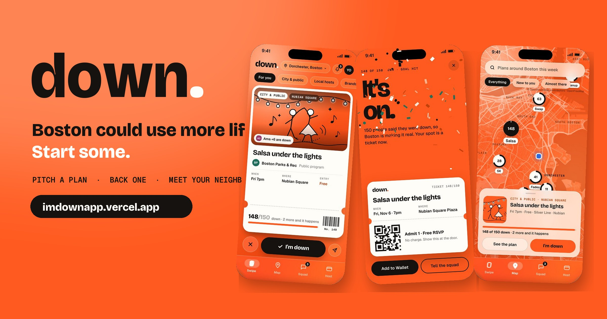</p>

<h2 align="center">Boston could use more life. Start some.</h2>
<p align="center">Pitch a plan or back someone else's. When enough people are down, it happens, and meet the neighbor whose dog's name you know but not theirs.</p>

<h3 align="center">👉 <a href="https://imdownapp.vercel.app">Demo link: imdownapp.vercel.app</a></h3>
<p align="center"><i>Best on a phone: open it in Safari → Share → <b>Add to Home Screen</b>. On a laptop it runs inside an iPhone frame.</i></p>

---

## The problem: "we should do something" almost never happens

Every city has the same broken loop:

- **People want to go out, but stay in their bubble.** You know your block, your campus, your commute. The neighborhood 15 minutes away on the Orange Line might as well be another city. Loneliness is now a public-health crisis; the U.S. Surgeon General called it an epidemic in 2023.
- **Organizers guess, then lose money.** A city books a band, a nonprofit orders 200 pairs of gloves, a small business rents a room. Then 12 people show up. Or the event never happens because nobody wants to take the first risk.
- **Good ideas die in the group chat.** "We should do karaoke after finals" gets 9 heart reactions and zero plans.
- **Cities lose their young people.** Boston trains a huge share of the country's graduates, and many leave because they never found their people or their places here.

The missing piece isn't more event listings. It's **proof that people will show up, before anyone spends a dollar.**

## The idea: plans that only happen if enough people are down

**down.** lets anyone pitch a plan that doesn't exist yet. People swipe on it. When enough people are down, it turns into a real event with tickets.

> **Tinder** for discovery (swipe right: "I'm down") × **Kickstarter** for commitment (a goal, all-or-nothing) × **Luma** for the event itself (ticket, wallet, reminders).

Every plan moves through four stages:

| Pitched | Heating up | **It's on** | Happened |
|---|---|---|---|
| Someone posts an idea | People swipe right and back it | Goal hit: spots become tickets | Your passport gets a new neighborhood stamp |

**Nobody pays for a plan that doesn't happen.** Free plans fill an interest bar. Paid plans hold your card and only charge if the goal is hit.

## Who it's for, with real-world examples

| Who | What they pitch on down. | Why it matters |
|---|---|---|
| 🏛️ **A city** (Boston Parks & Rec) | *Salsa under the lights* in Nubian Square: free lesson + live band, **only if 150 people are down** | Public money goes to programs residents have already proven they want. The app shows **"51 people backing this have never been to Nubian Square."** That's the impact metric cities can't get anywhere else. |
| 🌊 **A nonprofit** (harbor cleanup) | Piers Park shoreline cleanup + oyster shucking in East Boston | Volunteers commit *before* the dumpster and gloves are ordered. No wasted supplies, no empty shorelines. |
| 📚 **A library** | Zine night in Codman Square: risograph, scissors, old Globe archives | Programming backed by real demand, reaching neighbors who'd never walk into a branch otherwise. |
| 👟 **A brand** | Midnight sneaker swap on a Chinatown rooftop | Test a pop-up with zero risk. If 80 people aren't down, nothing is rented and nothing is spent. Real market validation in days. |
| 🍜 **A home cook or local host** | Bà Lan's Sunday phở supper: 12 seats at one long table | Sells out *before* buying ingredients. Hosts earn real money (see the Host tab: payouts, pledges, tips). |
| 🏃 **A community group** | Sunrise 5K in Franklin Park + jollof breakfast | Health, belonging, and a reason to discover a park you've never crossed. |
| 💬 **You and your friends** | "Karaoke in Chinatown after finals," pitched straight into the group chat | The squad votes on the spot. Once 3 of you are down, it opens up to people nearby. "We should…" becomes a date, a place and a crowd. |

## Why people come back: the Passport

Every plan you show up to stamps a neighborhood you hadn't been to. Your profile turns into a map of the city you actually know. **The goal isn't more events. It's more of the city, with people you wouldn't otherwise meet.**

---

## See it

### 1. A notification that brings you in
<p>
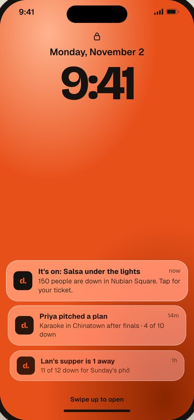
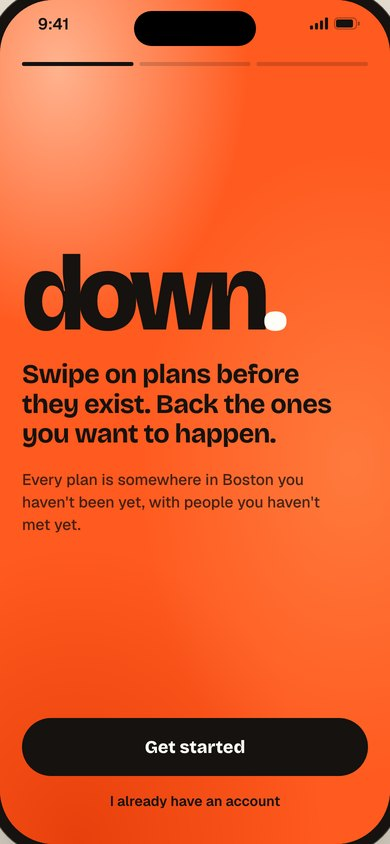
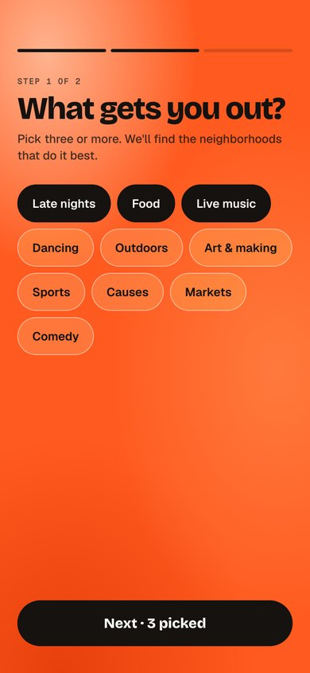
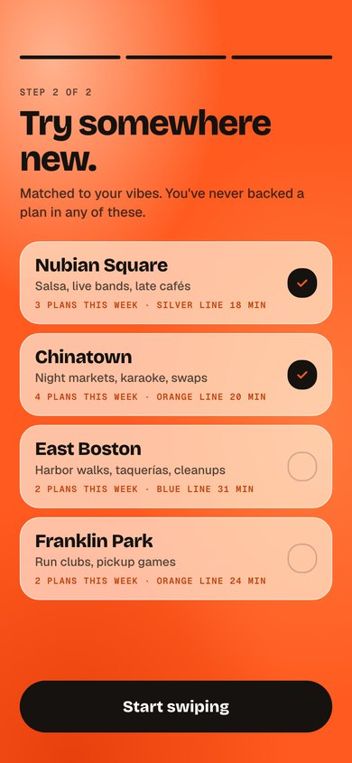
</p>

Swipe up to open. Pick what gets you out (late nights, food, live music...). down. suggests **neighborhoods you've never backed a plan in**, ranked by your vibes.

### 2. Swipe on plans before they exist
<p>
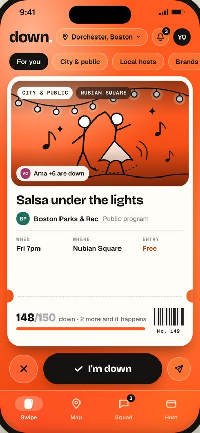
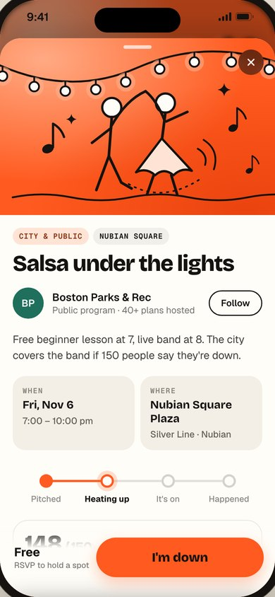
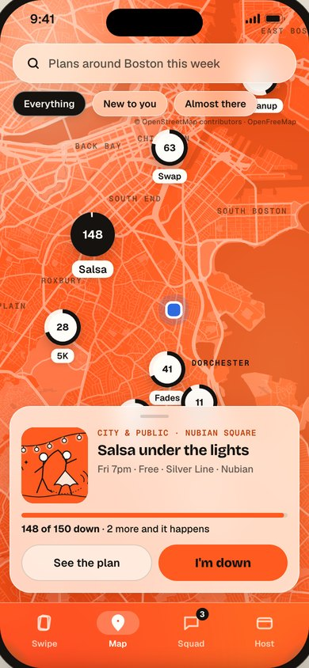
</p>

Every card is a ticket: who's hosting, when, where, and **how close it is to happening** (148/150). Tap for the full plan: stage tracker, who's down, and polls so backers shape the details. The map is a real **OpenStreetMap of Boston** with every plan at its real venue.

### 3. The moment it happens
<p>
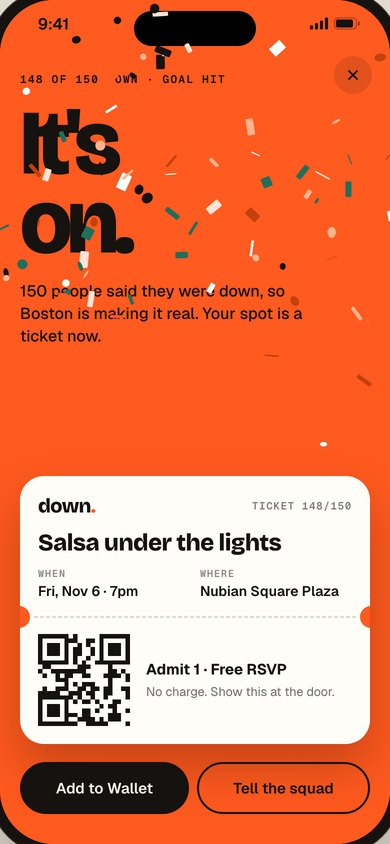
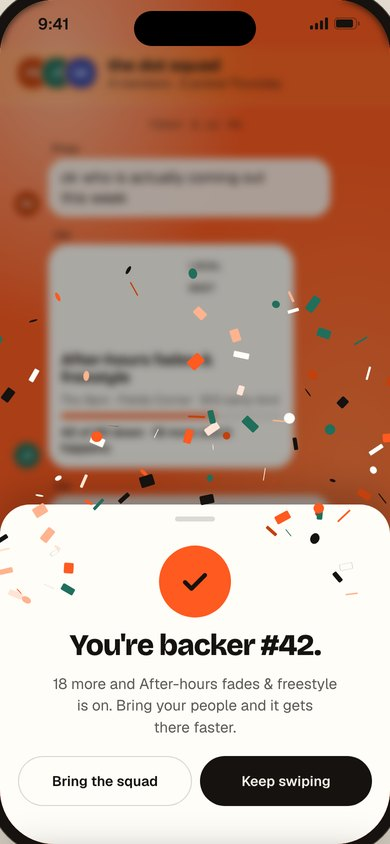
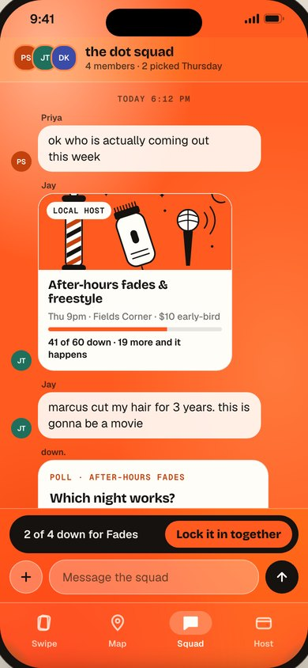
</p>

Swipe right on Salsa at 148/150. You're 149. Seconds later Ama joins: **150. It's on.** Confetti, and your RSVP is now a ticket with a QR code. Lock in a pledge for another plan and you're **backer #42**. Share it with your squad, vote on the night, lock it in together.

### 4. Anyone can host, and hosts get paid
<p>
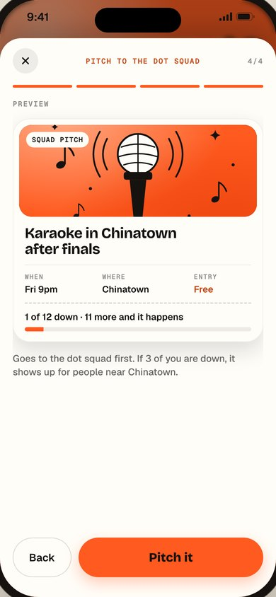
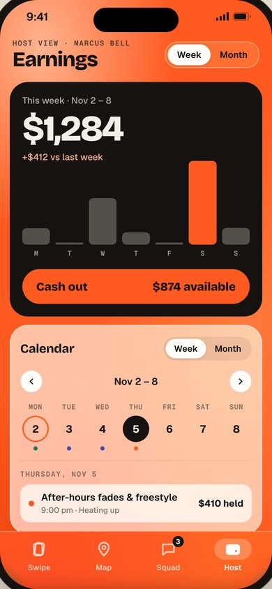
</p>

Pitch a plan in four steps: what & where, goal & price, a poll, preview. Hosts see earnings, held pledges, payouts and a calendar, plus insight like **"62% of your guests had never been to Fields Corner before your plans."**

---

## Try the 60-second demo

1. Open **[imdownapp.vercel.app](https://imdownapp.vercel.app)** and swipe up (or tap *Swipe up to open*).
2. **Get started** → pick 3 vibes → **Start swiping**.
3. Swipe right on **Salsa under the lights** (148/150). Watch it hit **150 → It's on.** 🎉
4. Tap the **down.** logo to see what you're going to. Check the **Map**, **Squad** and **Host** tabs.
5. Tip: tap the big **"It's on."** to replay the confetti.

## How it's built

- **One codebase, real native app:** React Native + **Expo SDK 58**, TypeScript, Expo Router. It runs on iPhone and Android (Expo Go, no App Store review needed) and on the web (this Vercel deploy).
- **Pixel-faithful to the design:** screens are generated from the design prototype's exact values (colors, type, spacing, motion) by `scripts/transpile.py`, rendered by a small CSS-to-native layout engine (`src/down/css.ts`, `ui.tsx`).
- **Motion:** Reanimated 4 + Gesture Handler 3 for the swipe stack physics, sheets, map panning and confetti.
- **Real map:** OpenStreetMap data (via OpenFreeMap vector tiles), rendered into the brand palette by `scripts/build-map.py`, with plans pinned at real Boston venues.
- **Art:** custom orange + black doodle illustrations for every event (`src/down/doodles.tsx`).
- **State:** Zustand store shared across tabs; seed data only, no backend needed for the demo.

```bash
npm install
npx expo start      # press w for web, or scan the QR code with Expo Go on your phone
./scripts/deploy-web.sh   # build + deploy the web version to Vercel
```

## Built with Kiro

The whole app was built in **Kiro**, starting from design reference images and a visual spec. The [`.kiro/`](.kiro) folder holds the working files:

| File | What's inside |
|---|---|
| [`.kiro/steering/`](.kiro/steering) | Product vision, tech rules and repo structure the agent followed |
| [`.kiro/specs/native-app/`](.kiro/specs/native-app) | Requirements (EARS), design and tasks for the 17-screen app |
| [`.kiro/specs/boston-map/`](.kiro/specs/boston-map) | The real OpenStreetMap layer: requirements, design, tasks |
| [`.kiro/specs/demo-launch/`](.kiro/specs/demo-launch) | Art, confetti, onboarding flow and the Vercel launch |
| [`.kiro/hooks/`](.kiro/hooks) | Agent hooks: typecheck on save, regenerate screens, pre-deploy check, build logging |
| [`.kiro/BUILD_LOG.md`](.kiro/BUILD_LOG.md) | Every build, check and deploy, with results |

## What's next

Real payments (card holds released on goal miss) · organizer dashboards for cities and nonprofits with "new-to-neighborhood" impact reports · campus and classroom pathways · more cities after Boston.

---

<sub>Map data © <a href="https://www.openstreetmap.org/copyright">OpenStreetMap</a> contributors, tiles by <a href="https://openfreemap.org">OpenFreeMap</a> / OpenMapTiles. Fonts: Bricolage Grotesque, Geist, Geist Mono (SIL OFL). All people, plans and numbers in the demo are fictional.</sub>
